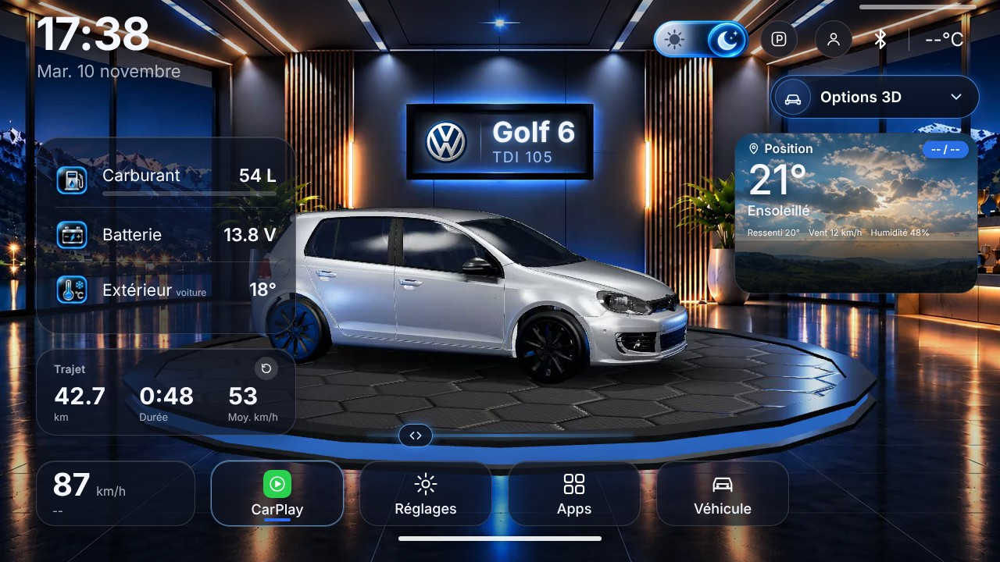
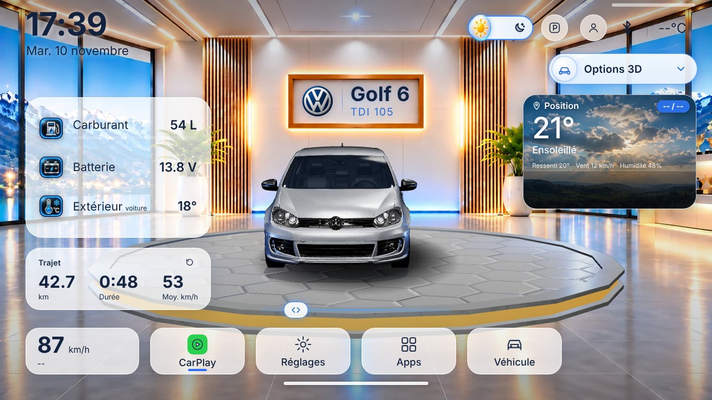
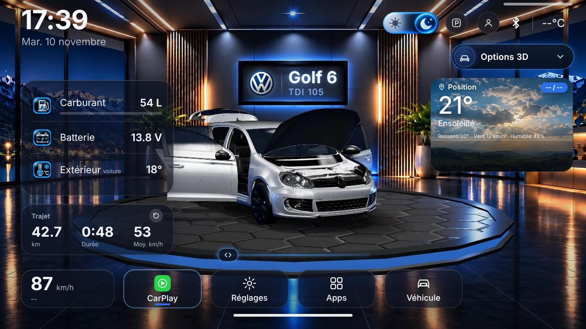
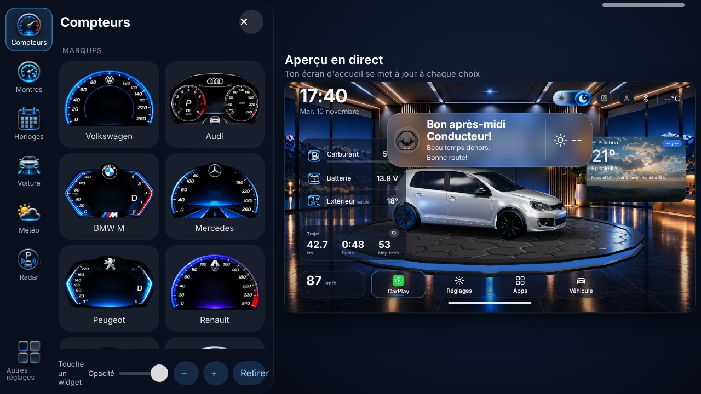
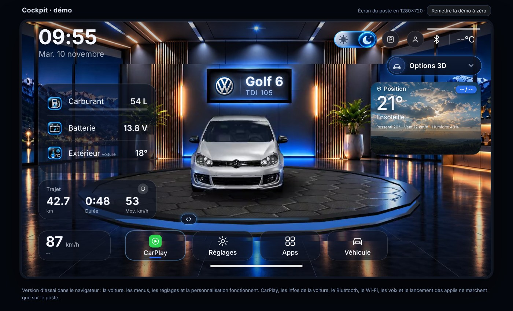

<div align="center">


# Cockpit

**L'interface d'accueil premium pour autoradios Android de voiture.**
Une voiture 3D qui tourne, des widgets à ta façon, un mode jour et un mode nuit, et les vraies infos de ta voiture.

[](#prérequis)
[](https://cockpitcarplay.netlify.app/)
[](https://github.com/clutchjojoo-tech/cockpit/actions/workflows/build.yml)
[](https://cockpitcarplay.netlify.app/)

[**Site officiel**](https://cockpitcarplay.netlify.app/) · [**Télécharger**](https://cockpitcarplay.netlify.app/) · [**Essayer la démo**](https://cockpitcarplaydemo.netlify.app/) · [**Contribuer**](CONTRIBUTING.md) · [**Signaler un bug**](https://github.com/clutchjojoo-tech/cockpit/issues/new/choose)

</div>

---

## Présentation

**Cockpit** est un *launcher* (écran d'accueil) gratuit pour les autoradios Android de voiture, de type ESSGOO, avec écran 1280×720. Il remplace l'accueil d'origine, souvent daté, par une interface sombre et métallisée aux accents bleu électrique, pensée pour la conduite : lisible, rapide, et entièrement personnalisable.

Cockpit n'est pas un lecteur CarPlay : il s'installe **autour** de ton application CarPlay habituelle (ZLink ou équivalent) et l'ouvre en un geste.

Le projet est développé par **Malola Studio**.

## L'écosystème Cockpit

Cockpit se compose de **trois éléments distincts**. Ce dépôt ne contient que le premier.

| Élément | Rôle | Où |
|---|---|---|
| **Cockpit Android** | L'application : son code génère l'APK | **Ce dépôt GitHub** |
| **Cockpit Download** | Le site officiel : téléchargement de l'APK et mises à jour des applications installées | [cockpitcarplay.netlify.app](https://cockpitcarplay.netlify.app/) |
| **Cockpit Demo** | Une démonstration interactive dans le navigateur | [cockpitcarplaydemo.netlify.app](https://cockpitcarplaydemo.netlify.app/) |

Cockpit Download et Cockpit Demo sont hébergés sur Netlify, **indépendamment** de ce dépôt. Leurs fichiers n'en font pas partie, et une modification de ce dépôt ne change rien à ces sites. Le détail de la chaîne de distribution est dans [docs/DISTRIBUTION.md](docs/DISTRIBUTION.md).

## Captures d'écran

<div align="center">

| Mode nuit | Mode jour |
|:---:|:---:|
|  |  |

| Portes ouvertes | Personnalisation |
|:---:|:---:|
|  |  |

<sub>Captures du mode démo, avec des valeurs d'exemple.</sub>

</div>

## Cockpit Demo : essayer dans le navigateur

**[Ouvre la démo : cockpitcarplaydemo.netlify.app](https://cockpitcarplaydemo.netlify.app/)**

Cockpit Demo est une interface web interactive qui reproduit l'écran d'un poste (1280×720) directement dans ton navigateur. Elle permet de découvrir Cockpit avant de l'installer, sans poste ni voiture.

<div align="center">



</div>

**Ce que tu peux essayer dans la démo**
- La voiture 3D : rotation, ouverture des portes, allumage des phares.
- Le mode jour et le mode nuit.
- Les menus et les réglages.
- La personnalisation : compteurs, montres, horloges, météo, fonds d'écran et widgets.
- Le bouton **Remettre la démo à zéro** pour repartir d'un état propre.

**Ce qui ne marche que sur un vrai poste**
- CarPlay, les infos réelles de la voiture (la démo affiche des valeurs d'exemple), le Bluetooth, le Wi-Fi, les voix et le lancement des applications.

> **Un projet indépendant.** La démo est un projet web à part, hébergé sur Netlify, séparé de l'application Android. Elle est mise à jour par Malola Studio quand Cockpit évolue : elle peut donc avoir un léger décalage avec la dernière version de l'APK. Son code n'est pas dans ce dépôt.

## Fonctionnalités

**Une interface automobile personnalisable**
- Compteurs, montres, horloges et styles météo au choix.
- Widgets que l'on déplace, redimensionne, rend transparents ou masque.
- Fonds d'écran en bibliothèque, ou une photo de ton téléphone.
- Profils conducteurs (avec code ou scan), chacun avec son style.
- Dix langues : français, anglais, espagnol, allemand, italien, portugais, néerlandais, polonais, roumain et turc.

**Une voiture en 3D**
- Visualisation 3D du véhicule, qui tourne seule ou au doigt, avec un curseur de rotation.
- Ouverture des portes et du coffre, vue éclatée.
- Allumage des phares.
- Plongée dans l'habitacle depuis l'onglet Véhicule.
- Rendu pré-calculé en vidéo : aucune carte graphique puissante n'est nécessaire.

**Jour et nuit**
- Deux ambiances complètes (showroom nuit et showroom jour), avec bascule en un bouton ou automatique.

**Les informations de ta voiture, selon ton matériel**
- Portes, coffre, vitesse, température extérieure, radar de recul animé avec la distance en cm, marche arrière, avertissements.
- Ces informations dépendent de ton boîtier CAN (par exemple CarCAN sur les postes compatibles). Quand une donnée n'existe pas, Cockpit l'indique : il n'invente jamais rien.

**Au quotidien**
- Voix d'accueil (Bonjour, Bonsoir…), alerte porte ouverte et risque de verglas.
- Touches Accueil, Retour et volume gérées par Cockpit.
- Personnalisation depuis le téléphone : on scanne un QR code et on règle tout en direct.
- Mises à jour intégrées.

## Installation

### Pour utiliser Cockpit

1. Rends-toi sur le **[site officiel](https://cockpitcarplay.netlify.app/)** et télécharge l'APK.
2. Sur ton poste, autorise l'installation d'applications inconnues, puis ouvre l'APK.
3. Définis Cockpit comme écran d'accueil par défaut quand Android te le demande.

### Pour le compiler toi-même

> **Important :** un APK que tu compiles toi-même n'est **pas** l'APK officiel et ne prouve rien sur son origine. Pour utiliser Cockpit, télécharge-le uniquement sur le [site officiel](https://cockpitcarplay.netlify.app/). Voir [docs/SIGNATURE.md](docs/SIGNATURE.md).

#### Sur ton ordinateur

```bash
git clone https://github.com/clutchjojoo-tech/cockpit.git
cd cockpit
gradle assembleDebug
# L'APK est dans app/build/outputs/apk/debug/app-debug.apk
```

Tu peux aussi ouvrir le dossier dans **Android Studio**.

#### Avec GitHub Actions

- **Contribution :** chaque pull request lance automatiquement une compilation de vérification. Elle ne signe rien et ne publie aucun APK.
- **APK officiel :** le workflow **Fabriquer l'application** (bouton *Run workflow*) est réservé aux mainteneurs. Il ne s'exécute que dans le dépôt officiel `clutchjojoo-tech/cockpit`, sur sa branche par défaut. Il vérifie la signature avec `apksigner` puis publie l'artefact **cockpit-apk** (`app-debug.apk`) seulement si la compilation **et** la signature sont conformes. L'artefact **journal-build** (`build.log`) est toujours disponible, même en cas d'échec.
- **Dans un fork,** ce workflow est ignoré : compile sur ton ordinateur.

## Prérequis

| Élément | Version |
|---|---|
| JDK | 17 |
| Gradle | 8.7 |
| Android SDK | plateforme 34 |
| Appareil visé | Android 5.0 (API 21) ou plus |
| Écran conseillé | 1280×720 |

Cockpit est développé et testé sur un poste ESSGOO sous Android 14, et sur une tablette Android.

## Comment c'est construit

Cockpit est une application Android légère : une activité Java qui héberge une interface web (`app/src/main/assets/index.html`) dans une WebView, et un pont Java ↔ JavaScript pour les informations du poste. La voiture 3D est pré-calculée en vidéos et en images pour rester fluide sur de petits postes.

Le détail est dans [docs/ARCHITECTURE.md](docs/ARCHITECTURE.md). La chaîne de distribution (APK officiel, site, mises à jour) est décrite dans [docs/DISTRIBUTION.md](docs/DISTRIBUTION.md).

## Contribuer

Les contributions sont les bienvenues : corrections, traductions, tests sur d'autres postes, idées.

- Lis d'abord le guide [CONTRIBUTING.md](CONTRIBUTING.md).
- Ouvre un [ticket](https://github.com/clutchjojoo-tech/cockpit/issues/new/choose) pour un bug ou une idée.
- Pour une modification du code, ouvre une *pull request* en expliquant ce qui change et sur quel poste tu as testé.

Merci de respecter le [code de conduite](CODE_OF_CONDUCT.md). Pour une faille de sécurité, suis [SECURITY.md](SECURITY.md) plutôt que d'ouvrir un ticket public.

## Licence

**La licence du projet n'est pas encore définie.** En l'absence de licence, tous les droits restent réservés par l'auteur : le code est visible, mais sa réutilisation n'est pas autorisée tant qu'une licence n'a pas été choisie.

## Crédits et ressources tierces

**Projet** : Cockpit est créé par **Malola Studio** (Jonathan Micoud).

**Modèles 3D** (licence [Creative Commons Attribution 4.0](https://creativecommons.org/licenses/by/4.0/), CC-BY 4.0)

| Modèle | Auteur | Source |
|---|---|---|
| « Volkswagen Golf 6. (A6) » | GT Cars: Hyperspeed | [Sketchfab](https://sketchfab.com/3d-models/volkswagen-golf-6-a6-8d8a301cee5143e9a6f25519e32dde21) |
| « round platform » | noortjeschuur | [Sketchfab](https://sketchfab.com/3d-models/round-platform-64de8f896e3e40e4a1e8a67d01620ac1) |

Ces modèles ont été modifiés : ils sont optimisés, éclairés, animés (portes, phares) puis pré-calculés en vidéos et en images pour être affichés par Cockpit. Les auteurs ne cautionnent ni Cockpit ni cette utilisation.

**Bibliothèque**
- [qrcode-generator](https://github.com/kazuhikoarase/qrcode-generator) de Kazuhiko Arase, licence MIT (fichier `app/src/main/assets/qrcode.js`).

**Services en ligne utilisés par l'application** (avec une connexion internet)
- [Open-Meteo](https://open-meteo.com/) : météo, recherche de villes et qualité de l'air.
- [GeoJS](https://www.geojs.io/) et [BigDataCloud](https://www.bigdatacloud.com/) : localisation approximative et nom du lieu.

**Voix** : les phrases d'accueil et d'alerte sont des enregistrements générés avec ElevenLabs.

**Marques** : les noms et logos de marques automobiles (Volkswagen, etc.) appartiennent à leurs propriétaires. Ils servent uniquement à identifier les véhicules et n'impliquent aucun partenariat. Cockpit n'est affilié ni à Volkswagen, ni à Apple, ni à ESSGOO.

---

<div align="center">

Fait avec soin par **[Malola Studio](https://cockpitcarplay.netlify.app/)**

</div>
